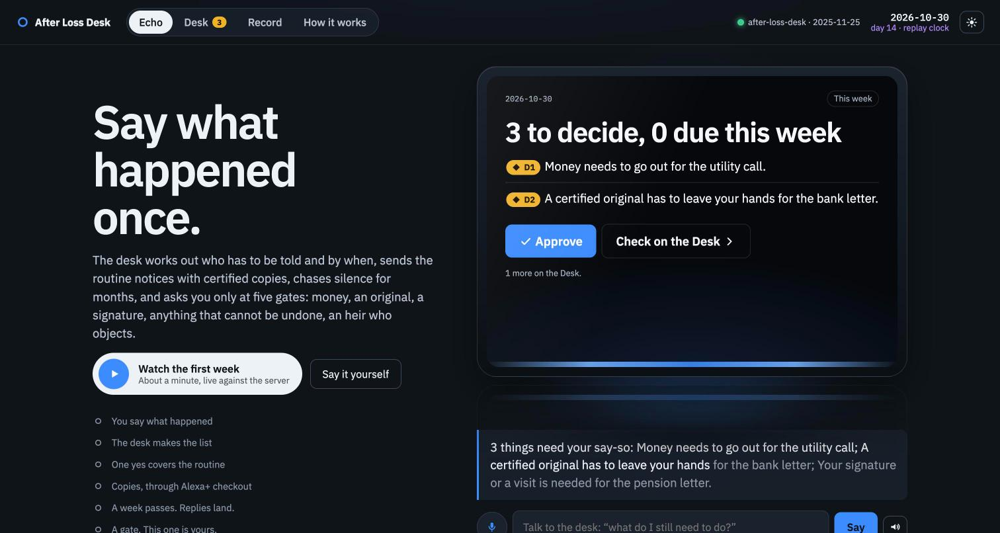
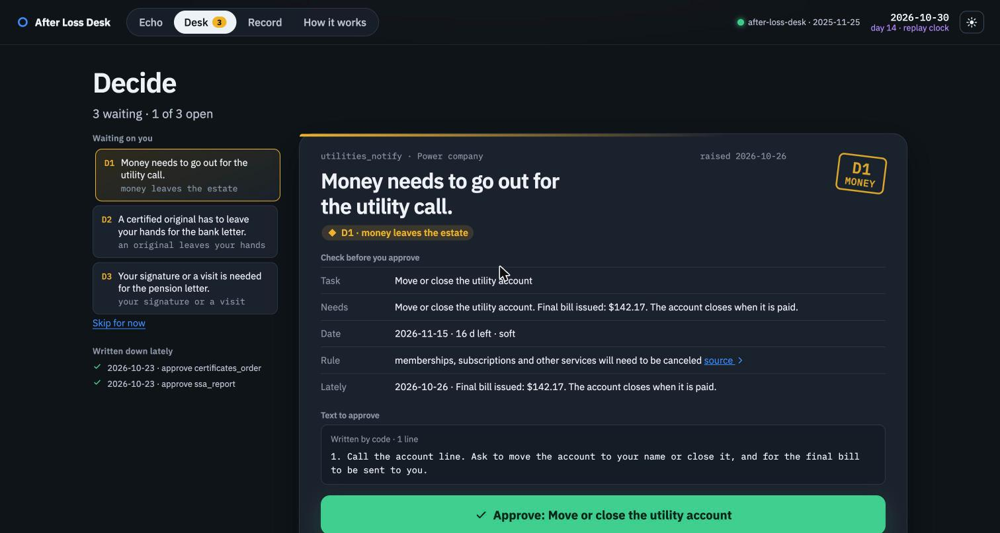
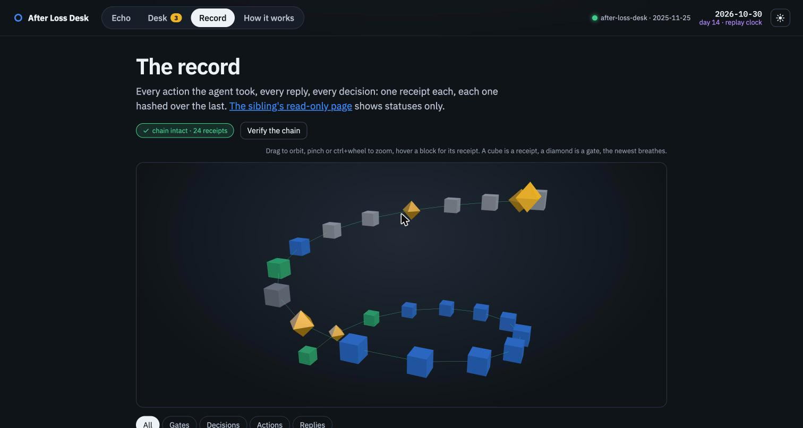
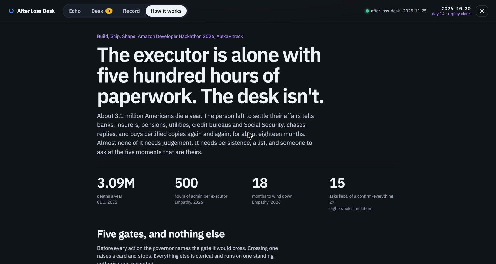
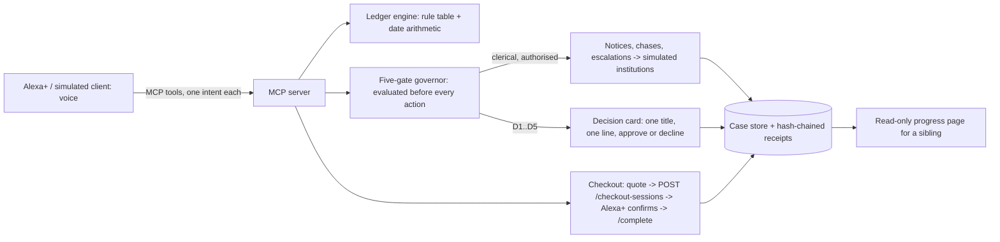

# After Loss Desk

**The executor's desk, on the Echo in the kitchen.** When someone dies, the person left to settle their affairs spends about 500 hours over about 18 months telling banks, insurers, pensions, utilities, credit bureaus and Social Security, chasing replies, and buying certified copies of the death certificate again and again. Almost none of it needs judgement. It needs persistence, a list, and someone to ask at the five moments that are hers.

After Loss Desk is an **Alexa+ add-on** (an MCP server, spec 2025-11-25, Streamable HTTP) that:
- builds the **ledger** of who must be told and by when from a cited rule table, computing every deadline from the date of death (California in this build);
- **drafts and sends** the routine notices with copies, chases silence, and escalates to certified mail, on one standing authorisation;
- **orders the certified copies** the open ledger will consume through **Alexa+ checkout** (the add-on quotes; Alexa+ confirms, picks the payment instrument and takes the PIN; `Idempotency-Key` honoured for 24 h);
- **interrupts only at five gates**, decided in code before every action: money leaves the estate, an original leaves her hands, her signature or a visit, anything irreversible, an heir objects;
- keeps **state for months** in a case store, with a hash-chained receipt for every action, and a read-only progress page for a sibling;
- **never speaks private data**: no names, no account numbers, no amounts by voice; institution names live on cards. Every spoken string passes a policy check in tests.

Built for **Build, Ship, Shape: Amazon Developer Hackathon 2026**, Alexa+ track, by Asish Kumar and Akash Kumar. MIT.

## See it in 60 seconds

The Echo: the card the executor sees across the room and the words she hears, with the case's day bar underneath. The Desk on a phone: check before you approve, then hold to approve. The record: every receipt as a block in a hash-chained 3D chain.

| The Echo (1440) | The Desk (phone-width) | The record |
|---|---|---|
|  |  |  |



Animated walk (start a case, allow routine notices, order copies through the checkout handoff, a week passes, a decision on the Desk, the record): [docs/demo.gif](docs/demo.gif).

- **Try it:** `uv run afterloss serve` → http://127.0.0.1:8300. Four pages: **Echo** (a room at night, the device, and a one-button guided story that runs the first week against the live server: you speak as subtitles, the desk answers word by word, a day counter rolls the week forward, tiles flip as notices go out, and a gate hands control to you), **Desk** (a queue of gates, a dossier to check, a stamp for the gate, hold to approve, decline with a reason), **Record** (every receipt as a hash chain you can orbit and verify), **How it works** (the pitch, the five gates, the architecture, the live scoreboard). The page is a real MCP client standing in for Alexa+ and says so at its foot. MCP endpoint: `/mcp`. Agent Skill: [SKILL.md](SKILL.md). MCP App card: `ui://afterloss/card.html`.
- **Design:** one meaning per colour, never colour alone (every state has a shape and a word), IBM Plex self-hosted, light and dark, keyboard shortcuts, reduced-motion respected. Tokens in `site/tokens.css`.
- **The measured claim:** `uv run afterloss simulate --weeks 8` (below). **The pitch:** [docs/PITCH.md](docs/PITCH.md). **Against the rubric:** [docs/JUDGING.md](docs/JUDGING.md). **Policy mapping:** [docs/POLICY.md](docs/POLICY.md). **Friction log:** [docs/FRICTION.md](docs/FRICTION.md).

## How it works



- **Model proposes, code decides.** Drafts come from templates with every fact filled by code (an optional language model may re-phrase; the draft is kept only if every fact survives). Which notices exist, their deadlines, how many originals they need, and whether an action may run are all computed, never generated.
- **The governor is not a prompt.** `governor.evaluate()` runs before every action; gated actions raise exactly one decision per task and gate and park the task. `governor.forbidden_actions()` scans the receipt chain for any gated action executed without an approved decision: the simulation and the test suite require it to be empty.
- **Voice policy in code.** `policy.violations()` rejects runs of three or more digits (except years, the 988 Lifeline and dollar amounts), institution labels the executor typed, and advice claims. Every `speak` string goes through it.

## The measured claim

`uv run afterloss simulate --weeks 8` runs the synthetic Okafor estate (eight institutions, a will, a car a brother objects to) with an executor who approves each decision the day it is raised, and scores the agent against a ground truth written before the run (`data/estate_demo.json`). The command exits non-zero if recall drops below 1.0, a forbidden action slips through, a spoken string breaks the policy, or the receipt chain fails to verify.

| | Result |
|---|---|
| Actions taken by the agent | 26 (autonomous 13, with approval 13) |
| Interruptions raised | 15 (agent asked first 14; 1 standing authorisation) |
| Interruption precision | **1.0** |
| Decision recall | **1.0** |
| Forbidden actions taken | **0** (must be 0) |
| Confirm-everything baseline | 27 interruptions |
| Tasks done | 17 / 17 |
| Missed deadlines | 0 |
| Days to settle the eight-week scope | 30 |
| Certified originals bought / left | 8 / 5 |
| Receipts in chain | 77, chain verified |
| Spoken strings checked / policy violations | 72 / 0 |

A confirm-everything agent would have asked 27 times. After Loss Desk asked 15, never missed a decision a careful executor would insist on, and never acted where the policy said it needed her.

## Run it

```bash
uv sync
uv run afterloss serve            # web client + MCP endpoint + checkout endpoints on :8300 (PORT to change)
uv run pytest                     # 21 tests: ledger, governor, checkout idempotency, voice policy, web endpoints, a real MCP client over Streamable HTTP, the simulation
uv run afterloss simulate --weeks 8
uv run afterloss policy-check
```

Configuration: `AFTERLOSS_DB` (SQLite path, default `data/afterloss.sqlite3`), `PUBLIC_URL` (used in share links and checkout URLs), `PORT`. Optional `LLM_BASE_URL`, `LLM_MODEL`, `LLM_API_KEY` for any OpenAI-compatible endpoint to re-phrase drafts. Docker: `docker build -t afterloss . && docker run -p 8300:8300 -v afterloss:/data afterloss`.

**Alexa+.** Alexa+ add-on tooling is in preview for select partners, so this build ships the contract Alexa+ consumes: a stateless Streamable HTTP MCP server (initialize, tools/list, tools/call; JSON responses), one tool per customer intent with closed schemas, `speak` under thirty seconds with at most five items, cards built to the add-on design guide (one title, one or two fields, one action, far-field type), and the documented checkout endpoints. The web page in `site/` is the MCP client that stands in for Alexa+ and is labelled "Simulated Alexa+".

## The rule table

`afterloss/rules/california.json`: every row has a source URL and a quoted line. Statutory: deliver the original will to the superior court clerk within 30 days (Probate Code §8200). Social Security: report by phone or in person only; the payment for the month of death must be returned (USA.gov, updated 31 Aug 2026). Credit bureaus: by mail with a copy of the certificate; Equifax takes no online death reports. DMV REG 5 from day 40. Certified copies: $26 each in San Diego County; ten is the usual count. Soft deadlines are marked `soft` and are ours; the add-on says so.

Adding a state is a new JSON file with the same shape. The adapters in `afterloss/adapters.py` simulate institutions (replies on fixed days: "we need a certified original", "sign and notarise", "final bill", silence that needs a chase) so the simulation is replayable; a deployment replaces them with letters, forms and calls.

## Policy

Alexa+ add-on policy (21 Jul 2026), as applied here: s.3 private personal information is never collected or recited by voice (closed enums; names and numbers only on the web client; test-enforced); s.4 adult account, nothing child-facing; s.9 legal lines are quoted from the statute and carry "That is the court's own rule, not legal advice"; s.13 the 988 Lifeline is in the first reply and no life-safety claim is made anywhere; s.14 checkout confirmation, payment instrument and PIN stay with Alexa+. Details: [docs/POLICY.md](docs/POLICY.md).

## Limits

- One state (California) and simulated institutions. The rule table is the thing to grow.
- The checkout flow is exercised by the simulated client and the tests, not by a real Alexa+ device (no entrant has one).
- The MCP App card uses the 2026-01-26 app protocol by hand (`ui/initialize`, `ui/notifications/tool-result`, `tools/call`); hosts without MCP Apps get the text result.
- Evidence numbers: CDC provisional 2025 deaths 3,094,593; Empathy's 2026 Grief Tax: about 500 hours, about 18 months (as reported by Insurance Business, 14 Sep 2026). Sources in [docs/PITCH.md](docs/PITCH.md).
